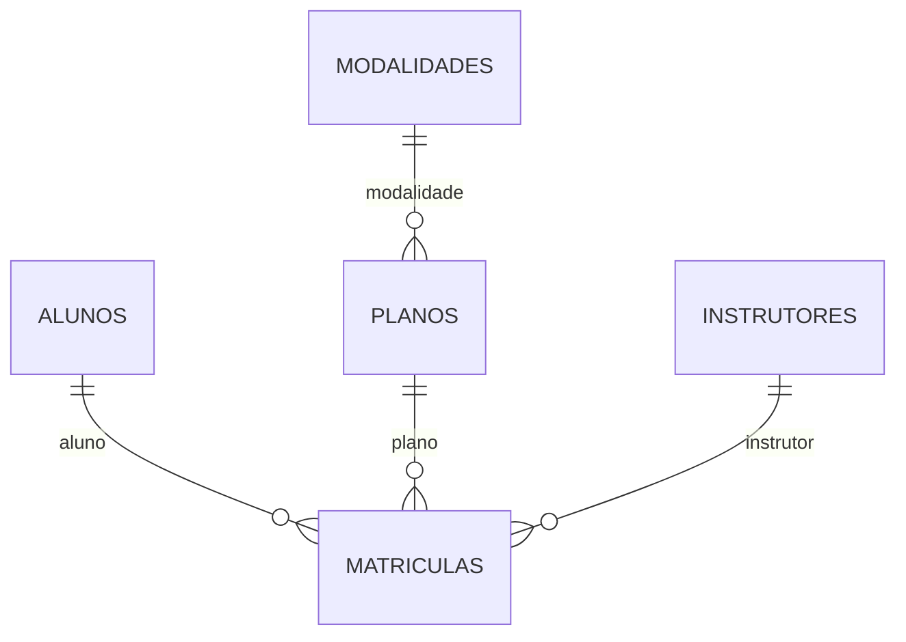

# Operação e Arquitetura — Turma da Bomba

Grupo 1 · Academia · Revisão do código em 11/11/2026

## Instalação local

Usar Node compatível com os manifests (o CI usa Node 22), npm e MongoDB disponível. Instalar dependências em backend e frontend com npm install, ou npm ci quando os lockfiles estiverem presentes e sincronizados. No PowerShell com bloqueio de npm.ps1, usar npm.cmd.

Na pasta backend:

```powershell
npm.cmd install
Copy-Item .env.example .env
node -e "console.log(require('node:crypto').randomBytes(32).toString('hex'))"
```

Copiar o valor aleatório gerado para JWT_SECRET no .env. Não manter o valor que começa com troque-: a API recusa esse prefixo mesmo com tamanho suficiente. Configurar o .env antes de iniciar o backend; não versionar esse arquivo. Copy-Item é um passo de primeira instalação: se já houver .env configurado, preservar e editar o existente.

| Variável | Função / padrão |
| --- | --- |
| MONGODB_URI | Conexão; fallback no código mongodb://127.0.0.1:27017/projeto-integrador |
| PORT | Porta HTTP; 3000 |
| JWT_SECRET | Obrigatória; ≥32 caracteres; sem prefixo troque- |
| FRONTEND_ORIGIN | Origem permitida por CORS; http://localhost:4200 |
| SEED_PASSWORD | Senha dos usuários criados pelo seed; padrão didático Admin@123 |

Continuar em backend, com MongoDB ativo:

```powershell
npm.cmd run seed
npm.cmd run start:dev
```

Em outro terminal, na pasta frontend:

```powershell
npm.cmd install
npm.cmd start
```

Interface: http://localhost:4200; API: http://localhost:3000/api/v1; Swagger: http://localhost:3000/api/docs. Ajustar apiUrl em frontend/src/environments/environment.ts se mudar a API. O ambiente atual usa usarMock:false. Serviços mock dos seis módulos continuam disponíveis para desenvolvimento; a autenticação depende da API real mesmo quando os serviços de domínio usam mock.

O seed é idempotente para os cadastros de exemplo e preserva alterações de registros existentes. Em banco vazio cria cinco alunos, instrutores, modalidades, planos e matrículas, além de três contas: admin@sistema.com, atendente@sistema.com e consulta@sistema.com. SEED_PASSWORD afeta somente contas novas; executar novamente não redefine senha nem restaura dados já alterados. Não há comando de reset do banco nesta documentação.

## Fluxo e organização

```mermaid
flowchart LR
  Tela[Angular: telas e formulários] --> Servico[Contrato de serviço / implementação HTTP]
  Servico --> Interceptor[Interceptor: Bearer na API configurada]
  Interceptor --> Guard[NestJS: JWT e perfis]
  Guard --> DTO[ValidationPipe e DTO]
  DTO --> Controller[Controller]
  Controller --> Regra[Service: regra de negócio]
  Regra --> Model[Mongoose: schema e índices]
  Model --> Banco[(MongoDB)]
```



A configuração global de prefixo, CORS, validação, interceptor de resposta e filtro está em backend/src/configurar-aplicacao.ts, reutilizada no bootstrap e nos testes integrados. main.ts configura Swagger e escuta a porta. AuthModule registra JwtAuthGuard e PerfisGuard como APP_GUARD, nessa ordem. Controllers validam parâmetros simples e delegam regras aos services.

No Angular, app.config.ts fornece HttpClient com interceptor, restauração de sessão, locale pt-BR, injeção por classe abstrata e rotas com vinculação de parâmetros a inputs. app.routes.ts protege a área interna, carrega módulos de tela por loadChildren e reserva relatório/criação administrativa para admin. Componentes usam signals, formulários reativos e serviços que retornam Observables. Cartões reutilizáveis recebem input e emitem output; a página organiza dados e operações.

Sucessos têm envelope em RespostaInterceptor; o frontend extrai dados. tratarErroApi transforma respostas em mensagens utilizáveis. ExcecoesFilter trata exceções HTTP, duplicidade MongoDB (11000), validação e conversão de tipos; retorna texto genérico para erros 500 e registra detalhes no servidor. Logs de negócio registram IDs e operações. Não existe coleção persistente de auditoria de eventos.

## Relações



Essas relações são implementadas por ObjectId/ref, não por chave estrangeira do banco. Usuarios é independente de alunos. Relatórios lê alunos/matrículas e faz lookup de planos; não precisa de coleção própria.

## Decisões técnicas documentadas a partir do código

Os registros abaixo consolidam o estado observado. Responsável indica o módulo no README; não afirma que a pessoa redigiu ou aprovou historicamente a decisão.

| ADR | Módulo / responsável | Contexto e decisão | Consequência / alternativa |
| --- | --- | --- | --- |
| ADR01 | Alunos / Vinicius | Calcular idade no service usando data de referência em São Paulo | Regra vale em criação/edição e chamada direta; somente validar no formulário não protegeria a API |
| ADR02 | Planos / Tiago | Referenciar modalidade e preencher nomes com populate | Evita duplicação; pressupõe integridade contextual no service em vez de embutir modalidade |
| ADR03 | Matrículas / Wolfegan | Usar índice único parcial para uma ativa por aluno e rota exclusiva de status | Garante unicidade sob concorrência; consulta prévia isolada é insuficiente |
| ADR04 | Instrutores / Andrieli | Inativar preservando CREF/e-mail únicos e referências | Mantém histórico; sem tela de restauração, recuperação depende da API |
| ADR05 | Modalidades / Bruno | Definir nome único por collation e capacidade inteira no schema | Evita duplicidade por caixa e valor fracionário; capacidade não equivale a controle de vagas |
| ADR06 | Relatórios / Alexa | Agregar dados atuais com countDocuments/lookup/group, sem coleção de totais | Evita sincronizar totais duplicados; receita muda quando preço do plano muda |
| ADR07 | Segurança / Wolfegan | JWT HS256 de 1h, bcrypt custo 10, sessionStorage e consulta de perfil atual no guard | Atualiza permissão a cada requisição; exige leitura no banco, ao contrário de confiar só no JWT |
| ADR08 | Integração / Tiago | Contratos abstratos no Angular com providers de mock/API | Telas preservam contrato; mocks não substituem testes de persistência |

## Verificação e fluxo de entrega

Em backend: npm test, npm run test:cov, npm run test:e2e e npm run build. Para lint sem alterar código, executar `npx.cmd eslint "src/**/*.ts"`; npm run lint usa --fix. Em frontend: npm run build. O frontend não possui script de teste automatizado em package.json.

O CI em .github/workflows/ci.yml executa lint, Jest e build de backend e build de frontend. A suíte test:e2e não está incluída nesse workflow. Aprovação local dos testes não comprova execução do CI nem publicação de versão.

O fluxo recomendado pelo material é branch de módulo → PR para develop → revisão/CI → PR para main e tag de entrega. Não foram criados commits, branches, PRs nem tags nesta tarefa.

## Limitações observadas e evolução

| Limitação | Efeito atual | Evolução possível |
| --- | --- | --- |
| Sem paginação | Listas retornam todos os resultados | Contrato paginado e índices conforme medições |
| Sem histórico de preço | Receita usa o valor atual do plano | Guardar preço contratado se houver requisito financeiro |
| Sem vencimento automático | duracaoMeses não encerra matrícula | Definir datas e política de renovação |
| Sem turmas/vagas | capacidadeMaxima é informativa | Modelar turmas, horários e ocupação |
| Sem recuperação de senha/gestão completa de usuários | Apenas criação e login disponíveis | Fluxo de recuperação e administração auditável |
| Inativos sem tela de recuperação | API aceita todos=true e ativo=true, interface não oferece esse fluxo | Tela administrativa de inativos |
| Referências sem transação entre coleções | Inativação não propaga nem cancela matrícula | Definir política de dependência e consistência |
| Comparação de status não protege toda edição simultânea | Duas edições no mesmo estado podem sobrescrever campos | Controle de versão se exigido |
| Conta consulta lê cadastros operacionais | Não é um portal restrito aos dados do próprio aluno | Rever política e vincular usuário/aluno se o produto exigir |
| Sem teste automatizado de interface | Suítes atuais validam backend | Automatizar fluxos essenciais e acessibilidade |

## Análise dos materiais da raiz e guia

README define equipe, stack e execução, mas ainda contém seções de preenchimento. COMECE-AQUI e CONTRIBUTING definem responsabilidades sobre arquivos e fluxo de integração. ATUALIZACOES descreve a evolução da base até base-v1.7; não prova que cada tarefa pedagógica foi concluída pelo grupo.

guia/README e GIT-E-GITHUB organizam o material e o fluxo de colaboração. RECEITAS fornece padrões de referências, inativação, datas, estados e mocks. Os roteiros de aulas disponíveis cobrem 02 e 07–15; as perguntas de 01 e 03–06 aparecem também no exemplo de respostas. Os seis templates orientam as seções dos documentos entregues.

Os cinco manuais de temas foram considerados na leitura do material: Academia é a fonte de requisitos deste grupo; Biblioteca, Clínica, Oficina mecânica e Pet shop são referências de outros domínios. Não foram incorporadas regras de empréstimo, consulta, ordem de serviço ou atendimento ao produto Academia. guia/exemplos usa um mercadinho fictício; seu conteúdo e percentuais de cobertura não são evidências deste projeto.

Diferenças relevantes resolvidas nos documentos: /auth/me em lugar de /auth/perfil do template; cadastro público adicional; rejeição de campo extra pela combinação whitelist/forbidNonWhitelisted; seed preservando dados; Produtos sem registro no AppModule; inativação dos quatro cadastros; e relatório com preço atual. Material pedagógico descreve intenção e exemplos; o código ativo define o comportamento registrado no contrato.

As respostas individuais são uma base técnica para estudo/revisão. Não foram atribuídas experiências pessoais, correções antigas, decisões aprovadas nem entregas de papel transversal sem evidência.
